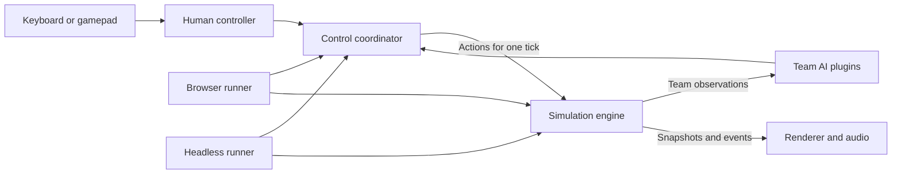

# Soccer Engine and AI Design

Draft for review before implementation.

Build a TypeScript soccer simulation with interchangeable team AI, customizable player abilities, and an independent renderer. The same simulation runs in a browser for human play and in Node for headless matches. Future training uses the engine through an adapter that exposes observations, actions, rewards, and episode completion.

## Decisions and proposed defaults

The agreed direction is TypeScript, separation of simulation and rendering, pluggable computer AI, and configurable physical and technical abilities. Headless model training is a future use case that influences the interfaces now.

The following are proposed starting defaults that can be adjusted during implementation and playtesting.

| Choice | Proposed default | Reason |
| --- | --- | --- |
| Match | Five players per team, including a goalkeeper | Enough players to develop passing and defensive coordination |
| World | Players move on a plane, ball moves in three dimensions | Supports ground passes, lofted passes, rebounds, and saves |
| Simulation | 60 fixed ticks per simulated second | Consistent movement and physical interactions |
| AI decisions | Every six simulation ticks, equivalent to 10 Hz | Separates tactical decisions from movement integration |
| Presentation | Stylized 3D with an elevated sideline camera | Keeps passing options and player selection visible |
| Initial AI | Rules and scored candidate actions | Easy to inspect and tune while developing gameplay |
| Observations | Full current match geometry and public player abilities | A simple first observation contract for comparing controllers |

Roster size, field dimensions, goal dimensions, ball properties, and match duration belong to configuration. The renderer library and numerical ability presets remain implementation choices.

## System boundaries



| Component | Owns | Boundary |
| --- | --- | --- |
| Engine | Match state, physics, abilities, rules, random outcomes, simulation time | Accepts actions and returns results through a synchronous API |
| Team AI | Tactics, player roles, movement targets, action choices, private memory | Reads team observations and commands its assigned players |
| Human controller | Input mapping, aim assistance, requested power, selection intent | Produces the same player action format used by AI |
| Control coordinator | Assignment of players to controllers, decision scheduling, pending commands | Produces exactly one effective command per active player per tick |
| Renderer | Meshes, animation, camera, visual effects, HUD, audio | Reads snapshots and events |
| Runner | Scheduling engine ticks, starting and stopping sessions, delivering results | Chooses real-time or accelerated execution |
| Future training adapter | Numeric observations, reward calculation, batching, episode boundaries | Advances the existing engine through its public API |

The engine depends only on shared contracts and simulation utilities. Browser APIs, graphics objects, audio, filesystem access, network communication, and wall-clock scheduling live in adapters. AI plugins depend on observation and action contracts. They receive isolated copies of observation data.

## World model and configuration

Use meters, seconds, kilograms, and radians. World `x` runs along the length of the pitch, `y` across its width, and `z` measures height. The center spot is `(0, 0, 0)`. Team attack direction is explicit and changes at halftime. The renderer owns the conversion into its graphics coordinate system.

Match configuration contains the versioned rules and tuning presets, pitch and goal dimensions, ball parameters, two team rosters, player definitions, and the length of each of two periods in ticks. The initial fixed tick rate is 60 Hz. Reset receives the random seed separately. Validate both at reset, including positive dimensions and period lengths, unique player IDs, valid goalkeepers, finite numbers, supported ability ranges, and an unsigned 32-bit integer seed.

Separate persistent definitions from changing match state.

| Data | Examples |
| --- | --- |
| Player definition | Identity, body dimensions, physical limits, technical skills, preferred foot |
| Player state | Position, velocity, facing, stamina, balance, current action, action phase and cooldowns |
| Ball state | Position, velocity, last touch, current control relationship |
| Match state | Tick, phase, score, period, restart placement and awarded team |
| Team controller state | Formation, marking assignments, intended receiver, decision history |
| Presentation data | Kit colors, appearance, camera preferences, animation assets |

The initial rules preset supports scoring, possession contests, standing tackles, ball exits, restarts, periods, and match completion. Fouls, cards, offside, penalties, substitutions, and detailed aerial contests are later rule extensions.

### Match phases and clock rules

The engine tracks an always-advancing simulation tick and a separate remaining match-clock count for the current period. A tick containing any positive interval of live play consumes one match-clock tick, including a tick that ends with a goal or exit. Setup and pause ticks consume simulation time only. The browser runner pauses by stopping advancement. Phase deadlines use simulation time.

The following durations are proposed arcade preset values, stored in the versioned rules data. Convert seconds to integer ticks at configuration validation.

| Phase | Placement and accepted actions | Exit condition |
| --- | --- | --- |
| Kickoff setup | Reset players to their formation in their own half, reserve the center for the taker, and anchor the ball there. Accept the taker's ground pass after a one-second placement interval. | Contact starts live play. After five additional seconds, schedule an automatic pass if the taker has no accepted action. |
| Live play | Integrate movement and all legal player actions. | Goal, ball exit, or end of period. |
| Goal pause | Freeze the world and reject new action requests for two seconds. | Start kickoff setup for the conceding team. |
| Restart setup | Anchor the ball at its restart spot, place the taker, and enforce the exclusion distances below. Accept the legal restart action after one second. | Contact starts live play. After five additional seconds, schedule an automatic restart if necessary. |
| Halftime | Freeze play for three seconds. | Reverse attack directions, reset formation and period clock, and start the second kickoff. |
| Full time | Preserve the final state. | Further step calls fail before mutation. |

Movement during setup and pauses is neutralized. An accepted restart action completes its bounded windup before contact, even if the input deadline passes. Every automatic action uses the same technique limits and execution lifecycle as a controller action. The timeout ends the input window and starts that action. These bounds guarantee progress under neutral input.

The configured first-kickoff team starts period one and the other team starts period two. At period expiry, finish resolving the current tick, count any valid goal in it, interrupt pending actions, and enter halftime or full time. Period expiry takes precedence over scheduling a new goal pause or restart. The initial preset uses the same stoppage behavior in browser and headless runs.

### Restarts and goalkeeper release

Restart classification uses the whole-ball exit position and last touch at the crossing time. A sideline exit awards a throw-in to the other team. At the goal line, an attacker last touching gives a goal kick, while a defender last touching gives a corner. A valid goal is classified before an ordinary goal-line exit. The initial kickoff establishes last touch. Live scenarios require last-touch data.

| Restart | Taker and placement | Legal execution |
| --- | --- | --- |
| Kickoff | Nearest outfield player to center before placement, with player ID breaking ties | Ground pass into the field |
| Throw-in | Nearest awarded-team outfield player to the exit point, placed at that touchline | Explicit `throwIn` request, releasing above the head toward the field |
| Corner | Nearest awarded-team outfield player to the corner on the exit side | Ground or lofted pass toward the field |
| Goal kick | Awarded team's goalkeeper at a configured spot inside the goal area | Ground or lofted pass toward the field |

Use the goalkeeper as taker if a roster has no eligible outfield player. Keep other players inside the field, resolve overlaps deterministically, and project opponents outside the configured exclusion radius, initially three meters. Kickoff additionally enforces the own-half and center-circle restrictions. Placement uses stable player order and a deterministic search for free positions. Reject configurations that cannot accommodate legal placement.

At timeout, the engine aims a mid-power legal restart toward the nearest teammate with an interior position, using player ID to break ties. If none exists, aim toward field center. If the ball is already at center, use the team's attack direction. Validate the commanded direction and constrain execution error to directions that enter the field, considering both boundary planes at a corner. The ball is anchored until contact, which transitions to live play. This excludes a failed reach check during the restart windup. Throw-ins use their own release height, speed cap, and animation event.

A successful goalkeeper catch creates a `keeperHeld` ball state inside that keeper's handling area. The keeper can move within the area and release through a `keeperRelease` request using a roll or throw. While holding the ball, the keeper's only legal new action is release. Physical ball contests resume at release. Opponents cannot tackle the held ball. A six-second deadline schedules an automatic mid-power roll, using the same targeting fallback as restarts. Validate save tuning so the remaining save and recovery interval after a catch is shorter than that deadline. Accepted releases finish their bounded windup. The timer counts as live play, and period expiry interrupts the hold or release. Keeper roll, throw, and throw-in speed limits are separate ability fields.

## Engine interface and tick behavior

The public API is synchronous. Each engine instance owns one match. These signatures describe the intended contracts, with domain records detailed in the surrounding sections.

```ts
interface MatchEngine {
  reset(config: MatchConfig, seed: number, scenario?: ScenarioDefinition): void;
  observe(teamId: TeamId): TeamObservation;
  step(frame: ActionFrame): TickResult;
  snapshot(): RenderSnapshot;
}

interface ActionFrame {
  tick: number;
  actions: readonly PlayerAction[];
}

interface TickResult {
  tick: number;
  events: readonly MatchEvent[];
  actionResults: readonly ActionResult[];
  diagnostics: readonly EngineDiagnostic[];
  status: "running" | "finished";
}
```

`reset` starts at state tick zero. A frame for tick zero advances that state to tick one, and the returned result carries tick one. A stale or future frame fails validation before mutation. Stepping a finished match also fails before mutation.

Validate and normalize the entire frame before integration. Malformed frames, such as duplicate player entries or non-finite values, reject the frame. Legal numeric commands receive bounded values. Gameplay requests that cannot execute, such as shooting while out of reach of the ball, produce a rejected action result while other valid actions proceed. Unknown or inactive player IDs are malformed input. Missing player entries receive neutral movement and no new action request.

Every tick follows the same order.

1. Validate the frame and collect all player intents against the current state.
2. Calculate movement intents and the scheduled action events due within the tick.
3. Advance bodies through one chronological event loop that includes player contacts, ball contacts, action contact times, goal crossings, and boundary exits.
4. Apply each event at its time of occurrence, update trajectories, and recompute candidates for the remaining interval.
5. Update exertion for elapsed action phases, advance clocks and phase deadlines, and apply any end-of-period transition.
6. Commit the new state and return events and action results for that tick.

Both teams choose from the same pre-tick observations. Joint integration and explicit conflict resolution determine the outcome of competing actions. Use swept collision checks within bounded substeps and a configured numerical tolerance to compare candidate event times. Advance all relevant bodies to the earliest event before resolving it. Recompute candidates after each contact so later crossings use the changed trajectory.

A goal requires the whole ball to cross the goal plane inside the opening. A goal or exit immediately ends live integration for the remaining interval, freezes play, and records the outcome. A later rebound in the same tick cannot reverse that result. A contact occurring before the crossing can prevent it. Commit the next phase and emit its transition event after end-of-period precedence is resolved, so a final-tick goal leads directly to halftime or full time. Phase pause timers begin at the next tick boundary.

For events within the time tolerance, resolve physical contacts first, then scheduled player contacts, then recheck crossing predicates. A valid goal takes precedence over the ordinary exit on the same plane. Stable player order and seeded tie-breaking resolve equivalent possession contests. Suppress separating contacts at zero time and bound event iterations. If the bound is exhausted, fail the run with a diagnostic so an unresolved high-speed trajectory cannot silently skip a boundary. Treat this as a simulation failure during evaluation.

Movement uses acceleration, braking, turning limits, and a speed cap. The ball has ground friction, gravity, bounce, and collision response. Keep these calculations independent of visual animation.

## Player actions and ball control

```ts
interface PlayerAction {
  playerId: PlayerId;
  movement: Vec2;
  sprint: boolean;
  request?: ActionRequest;
}

type ActionRequest =
  | {
      id: number;
      kind: "kick";
      kickType: "pass" | "shot" | "loft";
      direction: Vec2;
      power: number;
      loft: number;
    }
  | { id: number; kind: "tackle"; direction: Vec2 }
  | { id: number; kind: "keeperSave"; direction: Vec2 }
  | { id: number; kind: "throwIn"; direction: Vec2; power: number }
  | {
      id: number;
      kind: "keeperRelease";
      technique: "roll" | "throw";
      direction: Vec2;
      power: number;
    };
```

`movement` is a desired direction with magnitude from zero to one. The engine clamps its length. Kick direction is normalized and must be nonzero. Power and loft are normalized from zero to one, with the supported loft range determined by kick type. The engine converts these values into physical motion using the player and ball parameters.

The coordinator supplies a monotonically increasing request ID per player for the lifetime of the match. The engine consumes each request once, including rejected requests. Repeated or older IDs are ignored and reported as delivery diagnostics, with no second execution or terminal action result. Rule-generated automatic actions use a separate ID namespace. An action key contains its source, player ID, and request ID. Movement and sprint intent can persist between controller decisions, while one-time requests are delivered once. Existing windups and recovery phases continue in engine state.

Ball control describes a player’s opportunity to touch the ball. Dribbling uses bounded touches driven by movement and skill, with the ball retaining its own position and velocity. Sprinting can make touches longer and increase the chance of losing control. A receiving player must reach the ball and execute a first touch. A pass aim or tactical receiver designation provides no guarantee of possession.

Balls up to 58% of body height can be controlled with the feet, thigh or chest; higher ones are headers. Control gets less likely above a clean speed set by first touch, and a raised ball is harder to kill; a cushioned ball drops into the dribble pocket. A slow, low ball meeting a body is a touch, not a bounce: the dribbler running onto their own ball keeps it, a loose ball is trapped, and an opponent's body contests a dribble on tackling against dribbling (at most once per half second), otherwise shielding the ball with a soft bounce. A tackle on a dribble succeeds by the same contest, made easier by a heavy touch, and otherwise misses; a tackle at a loose ball pokes it away. The player who just played the ball does not block it with their own body. While a dribbler winds up a kick the ball moves with them. A kick struck more than 60 degrees from the way the player faces loses accuracy and power.

### Action lifecycle and feedback

Each player has one action slot, with `ready`, `windup`, `active`, and `recovery` states. Technique tuning supplies bounded durations in ticks. Kick contact is an instantaneous event at the end of windup. Tackles and saves have a bounded active interval. Aim, power, and technique lock when a request is accepted, while physical circumstances and execution error are evaluated at contact.

| Current state | New request or event | Result |
| --- | --- | --- |
| Ready | Valid legal request | Emit `accepted` and enter windup |
| Ready | Unavailable ball, illegal phase, or invalid role | Emit `rejected` with a reason and remain ready |
| Windup, active, or recovery | New action request | Reject as `busy`, consuming its ID |
| Windup | Scheduled contact remains legal | Execute contact, emit its outcome, then enter active or recovery |
| Windup or active | Loss of required ball control, successful opposing tackle, or loss of legal contact | Emit `interrupted` and enter bounded recovery |
| Active | Active interval expires | Enter recovery |
| Recovery | Recovery expires | Return to ready and emit `completed` if the action has no terminal result yet |
| Any action state | Goal, exit, or period change | Interrupt any outstanding action, clear the slot, and apply phase placement rules |

Initial actions accept no queued replacements. Movement continues subject to technique-specific speed and turning limits, and cannot cancel an action. Sprint is suppressed during windup and active execution. A new tackle request cannot replace the player's own shot windup. An opponent's successful tackle can interrupt it at the actual contact time. Recovery limits persist until their timer expires even after interruption, except when a match-phase transition clears the world for placement.

Within a continuing match, every accepted action has exactly one terminal result, `completed` or `interrupted`. Every refused new request has one `rejected` result. Reset disposes the old session and its unfinished actions together. Results include the action key, tick, state, and reason. Contact events report whether the action kicked, caught, parried, won the ball, or missed. The renderer receives action timing and contact events to synchronize animation.

The coordinator retains action results since each controller's previous decision and supplies them as own-team feedback, including the originating decision tick. It retains request-to-decision mappings until terminal delivery. Failures to obtain ball control are therefore available to AI retry logic. Public observations include visible action phases and contact events.

The human controller can translate a held button into requested power. Once submitted, that power follows the engine’s common execution timing. AI plugins can calculate power directly. Mechanical charging, if added later, must become an engine action phase available to every controller.

## Player abilities

Abilities affect actual outcomes inside the engine. Age is metadata and a way to choose an editable preset. A player can have lower physical power alongside excellent passing accuracy and close control.

```ts
interface PlayerAbilities {
  physical: {
    maxSpeedMps: number;
    accelerationMps2: number;
    brakingMps2: number;
    turnRateRadPerSec: number;
    maxKickSpeedMps: number;
    maxThrowInSpeedMps: number;
    maxKeeperRollSpeedMps: number;
    maxKeeperThrowSpeedMps: number;
    reachM: number;
    staminaDrainPerSec: number;
    staminaRecoveryPerSec: number;
  };
  technical: {
    passing: number;
    shooting: number;
    firstTouch: number;
    dribbling: number;
    tackling: number;
    goalkeeping: number;
    weakFoot: number;
  };
}
```

Physical values use explicit units. Technical ratings use the inclusive range zero to one. Body height, collision radius, and mass are separate physical definition fields. Runtime stamina and balance also use zero to one and are reset independently of the base abilities.

| Ability | Engine behavior |
| --- | --- |
| Speed and acceleration | Limit how quickly a player reaches a target and changes pace |
| Turning and braking | Limit direction changes and stopping distance |
| Kicking power | Limits the speed imparted by a deliberate kick |
| Passing and shooting | Control the spread around the requested aim and power |
| First touch | Controls the distance and direction of a receiving touch |
| Dribbling | Controls touch spacing and error while moving with the ball, and resistance to tackles and body challenges |
| Tackling | Affects tackle timing, reach within body limits, recovery, and the chance to take the ball from a dribbler |
| Goalkeeping | Affects save execution, dive reach, and catch control |
| Weak foot | Modifies execution when the contact geometry requires the weaker foot |
| Stamina | Modifies available exertion and execution through explicit curves |

Compute effective ability from base values and current circumstances. Shared tuning curves define fatigue, balance, movement, foot choice, and nearby pressure effects. Every modifier is bounded and named, so designers can understand why an action succeeded or failed.

A kick resolves in stages. Convert requested power into the selected technique's capped contribution to ball speed, apply bounded physical modifiers, derive an angular error scale from the applicable skill and circumstances, sample a seeded error, and apply the resulting velocity contribution at contact. Better accuracy monotonically reduces the error distribution under equivalent conditions. Incoming ball velocity and collision response can also affect the final ball speed.

### Kick techniques and ability limits

Each technique defines a speed multiplier, elevation range, base execution-error curves, windup, recovery, and movement limits. These are part of the versioned tuning preset. The following proposed initial envelopes make the techniques concrete. Angles are shown in degrees for readability and stored in radians.

| Technique | Maximum contribution relative to `maxKickSpeedMps` | Elevation range | Accuracy rating | Windup at 60 Hz | Recovery at 60 Hz |
| --- | --- | --- | --- | --- | --- |
| Ground pass | 0.55 | 0 to 5 degrees | Passing | 6 ticks | 8 ticks |
| Shot | 1.00 | 0 to 25 degrees | Shooting | 8 to 18 ticks with increasing power | 12 ticks |
| Lofted pass | 0.75 | 15 to 50 degrees | Passing | 12 ticks | 12 ticks |

Requested power scales from zero to the technique cap. Loft maps linearly into its elevation range. Fatigue and balance multipliers remain within zero to one, and sampled power error is clamped to the technique cap. Every technique has a bounded error curve with increasing error at high power. Weak-foot and pressure modifiers apply consistently. Switching the action label therefore selects its full physical envelope along with its skill rating.

All legal kicks can score. An accurate ground pass into an open goal is valid, and its ball-speed limit still applies. A lofted pass can clear a keeper while retaining its required elevation and preparation time. Scoring location does not change which skill controls execution.

Throw-ins and keeper releases use their dedicated physical speed caps. Their versioned presets define release height, elevation, contact delay, and recovery. Throw-in accuracy uses passing, keeper rolls and throws use goalkeeping. A roll starts at ball-radius height, a throw-in releases above body height, and a keeper throw releases near shoulder height. These techniques are legal only in their designated restart or held-ball states.

Define youth, teen, and adult presets as editable data. Preset values require gameplay calibration and should carry a tuning version. A skilled youth profile may combine reduced reach and kick speed with high first-touch and passing ratings. Size and age have effects only through the resolved attributes.

Computer decision traits belong to controller configuration. Reaction interval, awareness preferences, aggression, and risk tolerance guide the baseline AI. Custom plugins declare which traits they support. The engine consistently enforces physical and technical abilities across all plugins. A trained policy can consume ability values as observation features.

## Pluggable team AI

```ts
interface TeamAI {
  readonly id: string;
  readonly version: string;
  reset(context: AIContext): void;
  decide(
    observation: TeamObservation,
    assignment: ControlAssignment,
    context: TeamDecisionContext
  ): readonly PlayerIntent[];
  dispose(): void;
}
```

`AIContext` supplies the team ID, resolved player definitions, plugin configuration, contract version, and a controller-specific random seed. `ControlAssignment` contains the assigned player IDs and a revision number. `PlayerIntent` contains player ID, movement, sprint intent, an optional request payload, and optional pass-intention metadata. The coordinator stamps request IDs and converts these intents into `PlayerAction` records. `TeamDecisionContext` supplies own-team action feedback and active pass intentions. It is assembled by the coordinator separately from the engine's physical observation.

Each team gets its own plugin instance and private memory. The plugin’s random stream is separate from engine randomness. Changing a plugin’s internal sampling must leave the engine’s random stream untouched.

`TeamObservation` includes the state tick, phase, team attack direction, pitch dimensions, score, clock, ball motion, last touch, visible player states and abilities, and recent public events. It excludes engine random state and other controllers’ private memory. Initial observation permissions expose all current player geometry. The contract can add explicit visibility masks if limited perception becomes a game mode.

The coordinator delivers the same pre-tick world state to both teams. Engine observations carry the most recent tick's public events. The coordinator retains tick-result events and supplies each controller's observation with the complete event window since its previous decision. A slower controller can therefore observe a goal, first touch, or turnover that happened between decisions.

The baseline AI maintains a formation relative to ball position and attack direction. During possession it selects support positions, forward runs, and defensive cover. When defending it assigns one primary presser, supporting cover, and marking responsibilities. For a loose ball it compares estimated arrival times to choose a chaser. A goalkeeper uses a dedicated positioning and save policy through the common action interface.

Use hysteresis in role selection so players keep an assignment until another option is meaningfully better or play changes. Separate role selection from movement steering. The engine enforces speed, collisions, reach, and action validity for all resulting intents.

Plugins are registered factories selected by configuration. Initial plugins are trusted code running synchronously. The coordinator validates output shape, finite values, unique player entries, and ownership before accepting a decision. Commands for unassigned players invalidate the decision. Catch plugin exceptions and invalid decisions, issue neutral commands for affected players, and report the failure. Training evaluation treats controller failures as invalid runs. A worker adapter can later provide hard time limits and process isolation for expensive or external controllers.

## Human control and switching

Each active player has one controller owner for the next tick. A human session owns its selected player and the team AI owns the remaining players. Spectator mode assigns both complete teams to AI.

A new match resets engine state, controller memory, assignments, request counters, held input, and retained event windows together. Match instances own these resources independently.

Apply manual selection changes before gathering actions. Clear pending intents from the previous owner for affected players and trigger a fresh team decision after assignment changes. An engine action already in progress continues through its physical phase. Selection changes affect future commands.

### Pass intention and receiver handoff

```ts
interface PassIntention {
  action: ActionKey;
  receiverId: PlayerId;
  target: Vec2;
  createdTick: number;
  expiresAtTick: number;
  status: "proposed" | "accepted" | "inFlight";
  autoSwitchEligible: boolean;
}
```

Pass requests can carry a proposed teammate and target position as session metadata. Validate that the receiver is an active teammate distinct from the passer and that the target lies inside the field. This signal informs movement, while the engine continues to resolve actual contact and possession. Ground and lofted passes can carry the signal. Its initial lifetime is six simulated seconds from creation, including windup, stored in session configuration.

Before a tick, the coordinator applies manual selection changes, captures human input, stamps its request IDs, and exposes any proposed human pass to the team AI. The proposal triggers a decision for that team on this tick even if its regular decision interval is not due. The AI can move the receiver toward the target immediately. It receives the same pre-tick physical world as the other team. Own-team intentions stay private to that team's decision context.

AI decisions can submit their own pass intentions and the accompanying receiver movement in one output. The coordinator commits the complete decision atomically and publishes its intention in subsequent contexts. At most one team pass intention is active, and a newer valid pass proposal replaces the previous one. Commands still pass through engine validation. An `accepted` result advances the intention, and a kick-contact event marks it `inFlight`.

The engine attaches the initiating action key to the resulting ball flight and its reception event. Ground and post rebounds preserve that key. Any subsequent player touch ends the flight, with the touch, reception, or interception event identifying both the old key and the touching player. A confirmed first touch by the intended receiver completes the intention. It also schedules automatic selection for the next tick when the pass was human-requested and remains eligible.

Cancel the intention on rejection, interruption before kick contact, timeout, any other player's touch, ball exit, goal, period or restart transition, receiver deactivation, or replacement by a newer proposal. A terminal action result after a successful kick leaves the flight intention alive until reception or cancellation. Manual selection disables automatic switching for the pending pass but preserves the receiver's tactical signal until its normal completion. A manual selection on the reception tick takes precedence. Emit intention updates to the AI and clear expired intentions before gathering the next decisions.

Both the AI and renderer receive the updated assignment. The AI can account for the human player’s position and velocity while coordinating teammates. The renderer highlights the selected player. Camera-relative input is converted into world coordinates before entering the action pipeline.

## Rendering and audio

`RenderSnapshot` contains the state tick, player transforms and action phases, ball transform, match phase, score, clock, and presentation references. The browser runner captures an isolated snapshot after every completed physics tick and retains the latest two consecutive states. Headless execution can request only observations and tick results.

Let `dt` be one physics timestep and `accumulator` be the unconsumed real-time duration after stepping. Once it is less than `dt`, render transforms between states `n - 1` and `n` with `alpha = accumulator / dt`. This intentionally displays motion one physics tick behind simulation. At 30 FPS with 60 Hz physics, the final pair still differs by exactly one tick. At higher display rates, repeated renders interpolate the same pair.

Initialize both retained snapshots to the reset state. Discrete facts such as score and phase use the latest committed snapshot. Goal resets and other discontinuities carry a marker that replaces both retained transforms with the new placement. Match completion displays the terminal snapshot directly.

Animations follow engine action timing and movement. Footstep effects, crowd variation, and camera motion use presentation randomness. Engine events trigger kicks, whistles, saves, goals, and UI feedback. Event IDs contain the tick and an ordinal so each consumer can deduplicate delivery independently.

The renderer cannot establish ball possession, decide a collision, finish a kick, or advance the match clock. Visual meshes follow the physical definitions when their size affects gameplay. Cosmetic variations remain presentation data.

The browser runner maintains an accumulator using elapsed wall time and calls the fixed-step engine repeatedly. It limits catch-up work per display frame and pauses on a hidden tab or large scheduling gap. If that limit leaves a whole tick of backlog, it enters the same explicit pause path. On pause or resume, clear the wall-time accumulator, reset the timing origin, and align both retained snapshots to the latest state. This keeps interpolation alpha bounded. The headless runner advances ticks in a tight loop without real-time waits.

## Reproducibility and replay

The replay record contains engine and contract versions, resolved match and tuning configuration, the authored scenario when supplied, the resolved initial state, and the initial seed. It records the action frames submitted after controller arbitration, so playback passes them through the same engine normalization and can reproduce the match without running the AI. Rule-generated actions are reproduced by the engine and are identified as rule-generated in its events.

Use stable player ordering, explicit phase transitions, and a defined seeded generator. The initial determinism target is matching state hashes for the same engine build and runtime. Browser-to-Node equivalence is a verification target. Cross-runtime floating-point differences need measurement before claiming portable exact replay.

Observers receive isolated data. TypeScript read-only types support the API, while copies and development-time freezing prevent accidental state mutation at runtime. Avoid producing render snapshots during headless runs. Numeric buffer views can be introduced after profiling, with explicit ownership and lifetime rules.

Full session checkpoints can later include engine state, random streams, coordinator assignments, pending intents, and serializable controller memory. Recorded action replay from reset provides the initial reproducibility mechanism.

## Scenario reset contract

Normal `reset(config, seed)` creates the first kickoff. Supplying a scenario starts a validated authored situation at simulation tick zero. Tests, browser practice sessions, and headless evaluation share this interface.

```ts
interface ScenarioDefinition {
  version: 1;
  id: string;
  period: 1 | 2;
  remainingPeriodTicks?: number;
  score?: readonly [number, number];
  players: readonly ScenarioPlayerState[];
  ball: ScenarioBallState;
  phase:
    | { kind: "live" }
    | { kind: "kickoffSetup"; teamId: TeamId }
    | {
        kind: "restartSetup";
        teamId: TeamId;
        restart: "throwIn" | "corner" | "goalKick";
        spot: Vec2;
      };
}

interface ScenarioPlayerState {
  playerId: PlayerId;
  position: Vec2;
  facingRad: number;
  velocity?: Vec2;
  stamina?: number;
  balance?: number;
}

interface ScenarioBallState {
  position: Vec3;
  velocity: Vec3;
  lastTouchPlayerId: PlayerId;
  control:
    | { kind: "free" }
    | { kind: "dribble"; playerId: PlayerId }
    | { kind: "keeperHeld"; playerId: PlayerId };
}
```

Require exactly one state for every configured player. Missing player velocities default to zero, stamina and balance to one, score to zero, and remaining period time to that period's configured length. Resolve attack directions from the period. Set all action slots to ready, cooldowns and request counters to zero, and engine randomness to the supplied seed. A held-ball scenario starts a fresh goalkeeper release deadline. Observations begin with empty event and result windows.

For live scenarios, preserve the authored positions and velocities exactly after validation. Require finite coordinates, legal body and ball placement, valid last touch, non-overlapping players, and speeds within supported physical bounds. Remaining period ticks must be positive and at most the configured period length. Dribble control requires the ball to be within the named player's reach at a legal height. Keeper hold requires the designated keeper in its handling area, the ball at its defined hold point, and ball velocity consistent with the keeper's movement. A free ball can start in flight, provided its sphere is inside the field boundary and clear of solid geometry.

Setup scenarios use the standard phase placement procedure after validating the inputs. Authored positions determine nearest-taker selection, then placement resets affected transforms and velocities. The phase's canonical restart ball state replaces the supplied ball state, and setup timers start from zero. Validate a throw-in spot on the touchline, a corner spot at a field corner, or a goal-kick spot in the awarded team's goal area. Record the fully resolved initial state in the replay header so placement and default expansion are inspectable.

Validate a reset fully before replacing an existing match. On failure, throw a structured configuration or scenario error while preserving the existing match. Reset session-owned resources only after engine reset succeeds. Session reset clears controller memory, pass intentions, assignments, input, event cursors, renderer deduplication state, and interpolation history. Event identity is scoped to a session epoch so a delayed event from a previous match is discarded.

Scenario generation, including randomized positions, runs outside the engine and records its resolved output and generation seed. Repeating the same resolved scenario, engine seed, and action frames must reproduce the same state hashes. Situations requiring an action already in progress are constructed by stepping a short recorded setup sequence. Full mid-action checkpoint restoration belongs to the future checkpoint interface.

## Headless evaluation

The headless runner supports complete AI-versus-AI matches, repeated seeded scenarios through `ScenarioDefinition`, and fixed tick budgets. Run it from the repository with Node and the project dependencies installed.

```sh
npm run --silent evaluate -- match --seed 17 --replay match-17.json
npm run --silent evaluate -- verify match-17.json
npm run --silent evaluate -- benchmark --seed 17 --matches 5 --warmup 1
```

`match` and `benchmark` accept `--config`, `--scenario`, and `--teams` JSON paths and a `--max-ticks` budget. The default budget is 120,000 simulation ticks per match. The CLI ships with the baseline AI. The `evaluateMatch` and `benchmarkMatches` TypeScript functions also accept a custom `TeamAIRegistry` and JSON-compatible plugin configuration.

An evaluation records configuration, controller versions and seeds, final score, and the final state hash. A replay also records each submitted frame, and verification checks the initial state, tick sequence, and final result. Replays use the same engine version and runtime for exact comparisons. Controller failures invalidate the evaluation and identify the affected team and tick.

Benchmarks run fresh matches serially after warmup. The report includes engine ticks per second, completed matches per second, time spent in simulation and controller decisions, remaining coordinator overhead, and setup and reporting time. It reports tick-limited matches separately, with their ticks included in throughput. The CLI adds machine and runtime information and a process memory sample after the benchmark. Timings exclude warmup and replay recording and file I/O.

## Future headless training

The future training adapter exposes reset and batched stepping to a trainer.

One policy transition advances a configurable number of physics ticks, initially six. It submits a one-time request at the first tick and holds movement intent through the remaining ticks. It returns the observation after the final tick, accumulated reward, elapsed tick count, and completion flags. Match completion ends the transition early. Engine match completion maps to termination, while an external rollout time limit maps to truncation.

Training observations use versioned numeric fields, units, normalization, player ordering, and masks for variable roster sizes. A policy may transform coordinates so its team always attacks in the same direction, with the inverse transformation applied to actions. Human and rule-based AI adapters continue using the world-coordinate contract.

Rewards live in the training adapter. Goals, turnovers, possession, and progression can contribute through explicit reward definitions. Changing a reward function leaves match rules and physics intact. Opponent choice, seeds, player abilities, and match configuration are recorded with each evaluation.

For throughput, run multiple independent matches and batch observations and actions across the trainer boundary. Keep worker pools persistent and exchange compact buffers when profiling justifies them. Model training algorithms, GPU integration, and distributed execution belong to the later training phase.

Measure engine ticks per second, policy transitions per second, completed matches per second, memory per match, and time spent in simulation, controller inference, and transport. Report hardware, roster size, and configuration with benchmarks. Engine language changes follow measured bottlenecks. A replacement core must satisfy the same action, observation, and replay checks.

## Proposed source layout

```text
src/
  contracts/       Shared configuration, action, observation, and event types
  engine/          State, physics, player abilities, rules, seeded randomness
  controllers/     Team AI interface, baseline AI, human input translation
  session/         Control assignment, scheduling, replay recording
  render/          Scene, animation, camera, HUD, audio
  runners/         Browser and headless entry points
  presets/         Player, team, match, and tuning data
```

Keep these as module boundaries within one project initially. Engine imports are restricted to contracts and its own simulation helpers. Preset selection happens outside the engine and supplies fully resolved configuration.

## Implementation sequence and verification

| Stage | Deliverable | Completion checks |
| --- | --- | --- |
| Engine foundation | Normal and scenario reset, fixed ticks, movement, ball motion, goals, seeded execution | Invalid resets preserve the current match and repeated action replay yields identical state hashes in the supported runtime |
| Abilities and actions | Passing, shots, first touch, dribbling, tackles, goalkeeper saves and releases, throw-ins | Action lifecycles complete, technique bounds hold, and skill changes affect error distributions as intended |
| Control and AI | Team plugin registry, baseline tactics, human assignment | Every player has one owner and switching clears stale commands |
| Match flow | Restarts, periods, full time | Goals count once, boundary exits choose the correct restart, matches finish |
| Browser presentation | 3D pitch, player animation, camera, HUD, audio | The same recorded actions produce matching engine results with rendering enabled or disabled |
| Headless evaluation | Seeded matches, replay output, throughput measurements | Multiple instances remain independent and results include configuration and versions |

Targeted checks cover both correctness and playability. Exercise fast shots through the goal mouth, post rebounds, simultaneous possession contests, failed kick requests, request deduplication, and plugin exceptions.

| Contract | Required regression scenarios |
| --- | --- |
| Phase progress and clock | Neutral controllers eventually take every restart and release a held ball. Setup pauses the match clock, keeper holding consumes it, and a goal in the final live tick counts before the period transition. |
| Chronological resolution | A ball crossing the goal line before a later rebound scores once. A post or keeper contact before the crossing can prevent the score. A boundary exit prevents later contacts in the same tick. |
| Action lifecycle | Requests during windup and recovery reject as busy without restarting timers. A successful opposing tackle interrupts a shot. Every accepted action has one terminal result during a continuing match. |
| Pass handoff | A receiver gets the proposed target before contact. Confirmed reception switches once. Rejected kicks, deflections, interceptions, timeout, and restart transitions cancel pending handoffs. Manual selection disables automatic switching. |
| Rendering cadence | Simulated 30, 60, and 144 FPS schedules retain consecutive physics snapshots and bounded interpolation. Reset, catch-up pause, and terminal states display the correct placement. Engine state hashes match across those schedules. |
| Technique limits | A high-passing, low-shooting player retains the ground-pass speed cap when aiming at goal. Shot accuracy uses shooting. Lofted passes retain their elevation and preparation constraints. |
| Scenario reset | Authored live positions and velocities survive reset, defaults resolve consistently, and repeated seeded runs match. Invalid IDs, overlap, illegal possession, or invalid clocks reject atomically. Reset clears old feedback and pass intentions. |

For abilities, compare a fixed collection of seeds under equivalent conditions. A lower kick-speed limit reduces deliberate kick contribution. Higher passing skill reduces directional error statistically. A young skilled player can outperform a less accurate adult on passing while retaining lower physical limits.

Playtesting should demonstrate a connected passing sequence, a reachable through ball, a contested dribble, a save, and a score against an active goalkeeper. Tune the AI to maintain team shape and provide usable passing options. Store tuning changes in versioned presets so later comparisons remain interpretable.

## Reference material

The local videos provide visual references and examples of passing, switching, goalkeeper, and difficulty problems. Their transcripts describe behavior without specifying the underlying AI implementation. The architecture above is the proposed design for this project.

- [ChatGPT and Claude soccer game transcript](../sandbox2/1.txt)
- [ChatGPT and Gemini soccer game transcript](../sandbox2/2.txt)

Keep the elevated camera, clear team colors, selected-player indicator, and compact match HUD as initial presentation references. Use the receiving, goalkeeper, and dribbling issues described in the videos as concrete playtesting scenarios.
